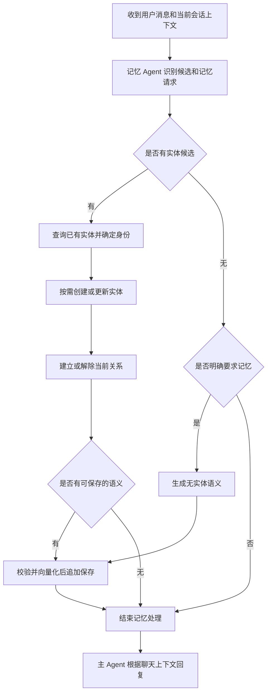

# 记忆系统 Spec 1.0

## 1. 背景与目标

依据 [draft_1_0.md](../drafts/draft_1_0.md)，建立由实体、实体结构化信息、语义信息组成的本地记忆系统。

系统从聊天上下文中识别可持续指代的实体，维护实体的当前属性与关系，并将值得记忆的内容向量化后持久保存。主 Agent 负责回答用户；记忆 Agent 负责提取、分析和调用存储工具。

本 Spec 定义功能行为、业务规则、技术设计与验收标准，不安排开发阶段或任务执行顺序。

### 1.1 已确认的需求补充

以下规则由用户于 2026-11-12 在本次会话中确认，作为 Draft 的补充，不修改原始 Draft：

| 编号 | 确认内容 | 对 Draft 的解释 |
| --- | --- | --- |
| C1 | 没有实体但明确要求记忆时，仍保存语义信息，`entities=[]`。 | “没有实体 → END”仅适用于同时没有明确记忆请求的情况。 |
| C2 | 追加变化后的语义，保留旧记录作为历史。 | 结构化信息反映当前状态；语义库允许同时保留不同时期的陈述。 |
| C3 | 本版实现提取与存储，主 Agent 使用聊天上下文回答。 | 不包含主 Agent 检索持久化记忆辅助回答；提取过程中的实体查询仍属于本版范围。 |

### 1.2 现有实现

- 项目使用 Python，`pyproject.toml` 要求 Python >= 3.13，已有 `uv.lock`。
- `src/memory/agent.py` 和 `src/memory/__init__.py` 为空，主 Agent、记忆 Agent 和运行入口尚未实现。
- `src/memory/milvus.py` 已提供 `create_client(dimension)`，使用 `.memory/memory.db` 和 `memory` 集合，字段为 `id`、`text`、`vector`、`entities`，相似度类型为 `COSINE`。
- 已声明 DashScope、LangChain、LangChain DeepSeek、Pydantic、PyMilvus/Milvus Lite。LangGraph 已存在于锁文件中，当前通过 LangChain 间接引入。
- `pyproject.toml` 已声明 `memory = "memory:main"`，但对应函数尚不存在。
- 当前未发现项目测试文件、Lint 或类型检查配置；`.memory/` 已由 Git 忽略。

实现应复用这些入口、依赖和存储位置，不另建一套存储后端。

## 2. 需求范围

### 2.1 本版包含

1. 初始化本地记忆目录和内置 Agent 实体。
2. 从当前会话上下文识别实体、指代、属性、关系及其变化。
3. 查询已有实体，创建新实体，更新实体当前状态。
4. 建立、解除实体关系，维护已确认关系的对应两端。
5. 生成带实体引用的语义文本，或不带实体引用的明确记忆内容。
6. 使用指定模型向量化，将语义文本、向量和关联实体存入本地 Milvus。
7. 主 Agent 基于聊天上下文回答，并如实反映明确记忆请求的执行结果。
8. 对无效输入、身份不明确、外部服务失败和本地写入失败给出明确处理结果。

### 2.2 本版不包含

- 持久语义记忆召回、重排、RAG 或跨会话记忆辅助回答。
- 会话记录持久化、跨会话自动识别当前用户、多用户身份认证与租户隔离。
- 实体合并、实体删除、语义记录删除或覆盖、全库语义去重。
- Web/API 服务、图形界面、后台任务队列和多进程并发写入。
- 跨 JSON 文件与 Milvus 的全局事务、自动数据迁移或自动重建已有数据库。

### 2.3 合理假设与设计约定

以下属于为使方案可实施而采用的假设或技术约定，**并非用户已逐项确认的需求**：

| 编号 | 假设或约定 |
| --- | --- |
| A1 | 单进程、单会话顺序处理消息；先执行本轮记忆处理，再生成主 Agent 回复。依据 Draft 示例中的执行顺序。 |
| A2 | 存储根目录为进程工作目录下的 `.memory/`，沿用现有 `milvus.py` 的相对路径行为。 |
| A3 | `relations` 是顶层字段值均为字符串这一描述的例外；扩展属性允许存在，但值也必须是字符串。依据 Draft 的字典结构和 `name` 示例。 |
| A4 | 复用已有 `memory` 命令声明，提供最小终端多轮聊天入口；会话只保存在进程内，不增加额外交互界面。 |
| A5 | Draft 中“用户发消息”段落的 `message-3-assistant` 视为示例角色笔误，验收时按用户消息处理；真实运行始终使用消息实际角色。 |
| A6 | 实体查询先采用本地 JSON 扫描与文本匹配，不增加独立索引或实体向量库。 |
| A7 | 记忆处理失败时，主 Agent 仍可基于聊天上下文回答，但不得声称失败的记忆操作已完成。 |

普通 UUID 的生成方式、工具参数、存储容量及错误返回格式由本 Spec 在下文明确，属于技术设计约定。

## 3. 数据模型

### 3.1 实体身份

- 实体是具有相对独立身份、可以被单独指代并在上下文中保持连续性的对象。
- “公司”“人”等泛指类型本身不因作为类型被提及而创建实体；具体公司、人物、地点、产品、项目或技术等可成为实体。
- 普通实体由程序生成 UUID v4，以标准小写、带连字符的字符串保存；模型不得自行编造持久化 ID。
- 内置 Agent 是唯一固定 ID 例外，使用 `agent`。
- 普通实体文件为 `.memory/<id>.json`；内置实体文件为 `.memory/agent.json`。文件名与内容中的 ID 必须一致。
- 实体创建后 ID 不可修改。同名实体不必然是同一实体；识别结果必须结合上下文及已有属性。

### 3.2 实体结构化信息

```json
{
  "id": "d85e5d30-f4f3-4b77-85ec-37cdf496a02b",
  "keywords": "黄志鑫",
  "agent_cognition": "一个喜欢玩游戏的人。",
  "relations": {},
  "name": "黄志鑫"
}
```

| 字段 | 类型 | 必填 | 规则 |
| --- | --- | --- | --- |
| `id` | string | 是 | 普通实体为程序生成的 UUID；内置实体为 `agent`。 |
| `keywords` | string | 是 | 可为空字符串；多个关键词使用英文逗号分隔。 |
| `agent_cognition` | string | 是 | Agent 对该实体的当前认知与描述；允许尚无充分认知时为空。 |
| `relations` | object<string, string> | 是 | 关系名映射到英文逗号分隔的目标实体 ID；无关系时为 `{}`。 |
| 其他属性，如 `name` | string | 否 | 按已知信息添加，不强制引入实体类型字段或固定属性全集。 |

序列化和更新约束：

1. 使用合法 UTF-8 JSON；除 `relations` 外，顶层所有值均为字符串，不接受 `null`、数字、布尔、数组或其他嵌套对象。
2. 关键词和关系 ID 列表拆分后去除首尾空白、空项与重复项，再以英文逗号连接。比较和去重保持稳定顺序。
3. 关系目标必须是已保存的有效实体，包括允许被明确指代的内置 `agent`；不保存悬空引用。
4. 删除关系的最后一个目标时移除该关系键，不保留空目标占位符。
5. 更新采取局部修改，未涉及的字段、关系类型和关系目标全部保留。不得用一次不完整提取覆盖整个实体。
6. 必填字段不可删除，`id` 不可更新；允许移除已经不再适用的扩展属性。
7. 结构化属性及认知表达当前已知状态。状态变化时，应同时处理受影响的属性、认知和关系，不让相互冲突的当前描述继续并存。

### 3.3 内置 Agent

首次初始化生成：

```json
{
  "id": "agent",
  "keywords": "",
  "agent_cognition": "我是一个智能体。",
  "relations": {}
}
```

已存在的 `agent.json` 不重新生成、不重置内容。若其内容无法解析或不符合实体约束，应报告数据错误并保留原文件，不用默认值覆盖。初始化重复执行不改变已有有效数据。

### 3.4 语义记录

语义信息包括与实体有关的事实、偏好、目标、状态变化，以及用户明确要求记住的内容。

| 字段 | 存储类型 | 规则 |
| --- | --- | --- |
| `id` | INT64 | Milvus 自动生成的主键；与实体 UUID 不同。 |
| `text` | VARCHAR | 非空语义文本，沿用最大长度参数 `8000`；写入前按 UTF-8 字节数检查。 |
| `vector` | FLOAT_VECTOR | 指定向量化模型生成的有限数值向量，长度必须等于集合维度。 |
| `entities` | ARRAY<VARCHAR> | 文本引用的实体 ID 去重列表；可以为 `[]`。设计容量为 1024，每个 ID 最大长度为 36。 |

- 已确定实体用 `[[实体id]]` 标记。`entities` 必须与文本中实体标记的去重集合一致，按首次出现顺序保存；引用目标必须存在。
- 工具校验关联列表与文本标记，不允许模型漏关联、多关联或引用虚构 ID。
- 无实体的明确记忆文本使用 `entities=[]`，例如 `1+1=3`；不为满足关联字段而创建虚构实体。
- 向量化输入采用最终保存的 `text`，不使用与持久文本不同的临时版本。
- 记录按追加方式写入。离职等变化产生新的语义文本，旧记录保留；不覆盖、删除或隐式标记旧记录失效。
- 历史信息通过“曾在……工作”“前同事”“已经离职”等表述区分。本版沿用现有四字段结构，不提供完整事件时间线或自动冲突消解。
- 旧记录中的现在时代表其写入时的认知，不代表现在仍然成立；实体 JSON 是当前结构化状态的依据。后续若引入召回，需要另行定义历史判定规则。
- 不要求全库去重；新语义可以带上理解本次变化所需的已知事实。没有新内容时可跳过保存，同一轮不主动重复保存相同结果。
- 超出文本或关联容量时，在完整事实边界拆分为多条记录并分别计算引用；单个不可拆分事实仍超限时返回错误，不截断内容。

## 4. 业务逻辑

### 4.1 输入与上下文

每轮输入由当前会话的有序消息和最新用户消息组成。消息至少包含真实的 `role` 与 `content`；最新用户消息是本轮处理触发点，前文用于理解指代和变化。

普通聊天记录、模型生成的分析以及工具执行结果应分开管理。记忆 Agent 的工具消息不得直接成为主 Agent 的聊天记录或自动成为新的记忆事实。助手回复可辅助理解语境，但不能仅因助手曾生成一句话就认定其为用户事实。

### 4.2 实体识别、查询与复用

1. 提取具体实体候选、指代、明确记忆请求及相关状态变化。
2. 有实体候选时，先查询本地实体，再决定复用或创建。工具返回候选集合，由记忆 Agent 结合上下文判断身份。
3. 已明确指向已有实体时复用其 ID，只更新确有变化的内容。
4. 查询无匹配且实体具有可区分身份时创建；保存工具返回真实 ID 后，才可生成使用该 ID 的关系或语义记录。
5. 同名、多候选或证据不足时，不自动合并、不任意选择、不通过新建同名实体规避歧义。未消歧部分暂不持久关联，独立明确的内容仍可处理。
6. 无法确定“我”的身份时，不创建匿名用户或固定 `user` 实体，也不将其关联到 `agent`。
7. 同一会话后续出现可靠自我介绍时，可以将前文同一说话者的“我”回溯到新确定的实体；不得跨未知会话推断身份。
8. 只陈述了过去成立的关系时，只生成相应历史语义，不将过去关系写为当前关系。

### 4.3 关系建立与解除

- 关系类型使用可扩展的字符串键，不限定封闭枚举。优先沿用已有实体中语义一致的关系名，避免同一含义反复使用不同名称。
- Draft 中雇佣关系统一使用人物的 `companies` 与公司的 `employees`。明确的同事关系可使用 `colleagues`，朋友关系可使用 `friends`；不沿用示例中将同事写成 `friends` 的展示笔误。
- 对语义已确定的逆向关系，两端均应更新。例如甲在乙公司工作：甲的 `companies` 增加乙，乙的 `employees` 增加甲。对称关系在两端使用同一关系名。
- 不能仅凭关系键名机械生成所有反向边；其他关系只有在上下文或关系语义明确时才建立其对应方向。
- 新关系以添加目标的方式更新，保留同类其他目标；解除关系仅删除指定目标，保留其他成员和其他关系。
- 明确“甲从乙公司离职”时，解除这对当前雇佣关系及已有的、可确定已失效的相关当前关系。不得将乙公司其他员工的雇佣关系一并解除，也不得从信息不足的关系中扩大推断。
- 两端尚无持久关系而上下文仅表明过去有关联时，无需为了再删除而先创建当前关系。
- 当前事实与历史事实应区分：离职后的旧任职关系留在语义历史中，不留在当前 `companies` / `employees` 中。

### 4.4 语义生成与保存

存在可记忆内容时，依据上下文和已确定的实体 ID 生成可独立理解的语义文本。可以把一组相关事实保存在同一条文本中，不要求与 Draft 示例措辞完全一致。

无实体且无明确记忆请求时结束记忆处理；无实体但明确要求记忆时直接进入语义保存分支。用户要求“记住 1+1=3”时保存其明确指定的内容，不擅自改成 `1+1=2`；保存某项陈述不等于对其客观真实性作保证。

当新内容改变已知状态时，先更新受影响的当前结构，再追加包含变化或历史描述的语义。已有记录保留，不将旧记录删除作为更新条件。

### 4.5 Draft 示例的规范化结果

以下 `E1`、`E2`、`E3` 仅为文档代称，运行时必须使用实际 UUID。

第一轮用户说：“你好，我在巨核科技工作，黄志鑫喜欢玩游戏，他是我的同事。”

- 创建或复用黄志鑫 `E1`、巨核科技 `E2`，不为身份未知的当前用户创建实体。
- 结合该示例上下文建立 `E1.companies → E2` 与 `E2.employees → E1`。
- 保存包含黄志鑫爱好和任职信息的语义，关联 `[E1, E2]`。不持久保存无法确定目标的用户关系。

同一会话第二轮用户说：“我叫谢佳鹏，我离职了。”

- 创建或复用谢佳鹏 `E3`，将此前同一用户的“我”回溯到 `E3`。
- `E1` 与 `E2` 的当前雇佣关系保留；不建立 `E3` 与 `E2` 的当前雇佣关系。
- 追加谢佳鹏曾在巨核科技工作、谢佳鹏与黄志鑫曾为同事等历史语义，关联实际出现的实体 ID。
- 第一轮语义记录继续保留。未存储的历史结构化关系不需要执行删除操作。

另一个必须支持的情形是：若 `E3` 在本轮前已经与 `E2` 存在当前雇佣关系，则离职时必须解除两端对应关系，再追加历史语义。

## 5. 技术方案

### 5.1 模块职责

| 位置 | 职责 |
| --- | --- |
| `src/memory/__init__.py` | 提供已有命令声明对应的 `main`，管理终端会话和资源生命周期。 |
| `src/memory/agent.py` | 主 Agent 及每轮调用编排；根据聊天上下文生成回复。 |
| `src/memory/agents/` | 记忆 Agent、提示词及工具绑定，完成提取、判断和工具调用循环。 |
| `src/memory/entities.py` | 拟新增：实体校验、初始化、查询、创建和局部更新，封装 JSON 文件访问。 |
| `src/memory/embeddings.py` | 拟新增：DashScope 向量化调用及返回值校验。 |
| `src/memory/milvus.py` | 复用并补全现有集合初始化、兼容性检查和语义写入。 |

工具输入/输出使用已有 Pydantic 依赖校验。实现可在上述职责内组织少量辅助函数，不新增独立服务或重复存储抽象。

### 5.2 模型、框架与配置

- 主 Agent 和记忆 Agent 使用 `langchain_deepseek`，模型名按 Draft 固定为 `deepseek_flash`。
- 向量化使用 DashScope，模型名按 Draft 固定为 `qwen3.7-text-embedding`。
- 模型名称在代码中以常量定义，不增加 `.env`，不改为用户交互选择模型。
- 凭据从已有系统环境变量读取；不打印密钥、不将密钥写入记忆文件。具体 SDK 调用使用项目锁定版本支持的接口。
- 使用 LangChain 构建模型与工具交互，使用 LangGraph 管理状态和条件转移。源码直接使用 LangGraph 时应将其显式列为项目依赖，沿用锁文件中的兼容版本。
- 指定模型名来自 Draft，不将本次文档检查当作外部服务可用性验证。模型不存在、无权限、工具调用不可用或接口不兼容时应报告对应错误，不静默切换模型。
- 向量维度不凭模型名称猜测：空库以首次有效语义向量的实际长度建立集合；已有集合读取其维度并校验后续向量。无语义需要保存时不为探测维度额外调用模型。

### 5.3 每轮流程与状态



流程图表达业务先后关系，不要求每个方框独立实现为一个 Graph 节点。记忆 Agent 可在同一轮多次调用工具，以实际工具结果继续判断；必须有有限的工具循环/Graph 步数上限，触及上限时停止并返回未完成状态。

运行态包含会话消息、本轮工具结果、已解析实体映射、待处理变更及记忆处理状态。上述中间数据仅用于本轮编排，不作为额外持久记忆格式。

每轮调用返回主 Agent 回复及记忆处理状态：

- `completed`：本轮所需操作全部得到成功确认。
- `skipped`：无需要保存的内容或变化。
- `partial`：部分独立内容成功，其他内容未消歧或执行失败。
- `failed`：本轮所需处理无法完成，且没有已确认成功的写入。

状态附带已成功写入的实体/语义 ID、未完成原因和失败步骤；这些是内部执行结果，不要求将全部工具细节展示给用户。主 Agent 不读取实体查询结果或语义库作为持久知识来源，只接收必要的执行状态以避免虚假确认。

### 5.4 工具接口

下面为逻辑接口约定，使用结构化参数绑定给记忆 Agent；工具不得接受任意文件路径或任意可执行代码。

#### 查询实体 `query_entities`

- 输入：`ids: list[str]`、`keywords: list[str]`，至少有一组有效条件。
- 按 ID 精确匹配；关键词对 `keywords` 拆分项、`name` 和 `agent_cognition` 做去首尾空白、大小写归一后的文本包含匹配。
- 多个条件按“或”合并，结果按 ID 去重并稳定排序，返回完整实体列表；无结果返回 `[]`。
- 查询仅提供候选，不宣称文本匹配已经完成身份确认。空查询拒绝执行，避免误把全库当作匹配结果。

#### 创建实体 `create_entities`

- 输入：实体初始属性列表，不包含 `id`；`keywords`、`agent_cognition` 缺省为 `""`，初始 `relations` 为 `{}`。
- 由程序生成 UUID，保存成功后按输入项返回完整实体。创建与关系建立分开，避免引用尚未生成的 ID。
- 不覆盖同 ID 文件；名称不是唯一键，不对同名实体强制合并。

#### 更新实体 `update_entities`

- 输入：变更列表，每项包含 `id`、`attributes`、`remove_attributes`、`relations_add`、`relations_remove`。
- `attributes` 为需要设置的字符串属性，不允许包含 `id` 或 `relations`；`remove_attributes` 仅允许扩展属性名。
- `relations_add` / `relations_remove` 均为关系名到英文逗号分隔目标 ID 的映射，采用集合添加/移除语义，沿用实体文件格式。
- 同一字段不能同时设置和移除，同一关系目标不能在同一项中同时添加和移除。同一实体在一批中只出现一次；冲突参数整体校验失败。
- 对已有目标重复添加或对已移除目标重复移除可作为无变化成功返回。未提及的内容保留。
- 双向关系变更在同一工具调用中提交两端；工具先校验整批变更，再逐实体落盘。输出每项结果及更新后实体，不能将部分成功报告成整批成功。

#### 保存语义 `save_semantics`

- 输入：记录列表，每项包含 `text` 和 `entities`；模型不提交向量或语义主键。
- 校验文本、引用和容量，调用向量化服务，校验维度和数值，再追加写入 Milvus。
- 返回每条已确认保存记录的主键、文本和实体列表；不将向量全文作为工具返回提供给语言模型。
- 本工具不覆盖旧记录，也不提供检索接口。

工具返回统一包含执行状态、成功数据和错误信息；批量操作保留输入项与结果的对应关系。参数或批次前置校验不通过时不开始写入，执行中出现 I/O 或服务错误则如实列出已经成功和未完成的项。

### 5.5 持久化与兼容性

- 初始化时创建 `.memory/`，检查内置实体；语义集合可在首次有效向量到达后延迟初始化。
- 复用 `.memory/memory.db`、`memory` 集合和现有四字段设计，显式定义数组容量与元素长度。
- 已有集合应检查必需字段、类型、主键/自动 ID 设置、文本与数组容量及向量维度；不兼容时报告差异并保留原数据库，禁止自动删除重建。
- 单个 JSON 文件采用同目录临时文件加原子替换，创建时防止覆盖既有实体。只使用校验后的 UUID 或 `agent` 构造路径；拒绝路径片段和符号链接形式的实体目标。
- 写入关系前确保目标存在；引用实体的语义应在对应实体及本轮相关关系变更成功后保存。无关且明确的内容可独立继续。
- 多文件与数据库之间不承诺全局原子性。中途失败时报告已成功项并停止依赖失败步骤的操作，不为掩盖失败自动删除已保存数据。
- 数据库写入超时且结果无法确认时标记“结果未知”，不报告成功，不自动盲目重试。重新执行追加操作可能产生重复记录，本版不承诺跨重试的恰好一次写入。
- 正常退出和异常结束时关闭数据库客户端及其他持有的资源。

## 6. 异常与边界

| 情形 | 处理规则 |
| --- | --- |
| 空白用户输入 | 不触发模型或存储写入；终端继续等待输入。 |
| 无实体、无明确记忆要求 | 记忆处理为 `skipped`，主 Agent 正常回答。 |
| 身份或关系归属存在歧义 | 不猜测并写入；保留未消歧原因，处理其他独立明确内容。 |
| 只知道历史关系 | 保存历史语义，不生成当前关系。 |
| 当前会话含有时间变化 | 根据明确时间和语境识别当前状态；后出现的历史回顾不直接覆盖已经确认的当前状态。 |
| 用户明确纠正某条信息 | 更新受影响的当前结构，追加纠正语义；旧语义继续保留。 |
| 非法 ID、字段类型或悬空引用 | 校验失败，不写入非法内容。 |
| 现有 JSON 损坏或文件名与 ID 不符 | 报告文件数据错误并保留原文件；不能将读取失败解释成实体不存在后创建替代实体。 |
| 密钥缺失、模型不可用、模型输出不合法 | 返回具体步骤错误，不生成伪造实体或伪造保存结果；有限纠正后仍失败则结束记忆处理。 |
| 向量化失败、空向量、非有限数值或维度不符 | 不写入该语义，报告错误；已保存实体保持原状。 |
| 存储格式不兼容或本地写入失败 | 保留既有数据；报告失败或部分完成，不自动迁移、清库或回滚无关数据。 |
| 关系两端只有一端写入成功 | 返回部分失败及两端结果，不宣称关系更新完成；暂停依赖这次关系变更的语义保存。 |
| 明确记忆请求未完全成功 | 对用户如实说明未完成的记忆，不能回复“已经记住”掩盖失败。 |
| 主 Agent 调用失败 | 报告回答失败；已成功写入的记忆不因此删除。 |
| 超出上下文或外部模型输入限制 | 明确失败，不静默丢弃用于身份和关系判断的历史上下文；本版不增加自动摘要机制。 |

## 7. 验收标准

验收关注数据状态和可观察行为，不要求模型逐字复现示例认知或语义文本。以下是验收场景定义，不要求为它们新建测试文件。

| 编号 | 场景与输入 | 可验证的完成条件 |
| --- | --- | --- |
| AC-01 | 首次启动与重复启动 | 首次创建内置 `agent.json`；重复启动保留已有内容；文件格式符合第 3 节。 |
| AC-02 | “记住 1+1=3” | 保存 `text="1+1=3"`、`entities=[]` 和有效向量，不创建虚构实体。对应 C1。 |
| AC-03 | 既无实体、也无明确记忆请求的普通问候 | 不新增普通实体或语义记录，主 Agent 可正常回答。 |
| AC-04 | Draft 第一轮示例 | 黄志鑫和巨核科技具有有效 ID；不存在匿名用户实体；两端雇佣关系和语义关联正确。 |
| AC-05 | 同一会话随后自我介绍并离职 | 创建或复用谢佳鹏；保存其历史任职和前同事语义；不建立其当前雇佣关系；黄志鑫任职关系保留。 |
| AC-06 | 再次明确提及同一已有实体 | 查询并复用原 ID，按需更新；不因再次提及而新建重复实体。 |
| AC-07 | 查询得到多个同名人物，信息不足 | 不自动合并、不随意选择、不修改任何一个候选的归属关系。 |
| AC-08 | 实体已有多个属性、多个关系目标，只变更其中一项 | 指定项改变，其他属性及目标原样保留；字段类型、必填项和 ID 约束成立。 |
| AC-09 | 已有当前雇佣关系，随后明确离职 | 两端对应目标被移除，其他员工或公司关系保留；追加历史语义，旧语义记录及其主键仍存在。对应 C2。 |
| AC-10 | 建立已明确的双向关系或对称关系 | 所有目标引用真实已保存实体；相关两端均正确更新，重复添加不产生重复目标。 |
| AC-11 | 保存引用多个实体的语义 | 文本标记与 `entities` 去重集合一致，向量维度符合集合；无引用文本使用空数组。 |
| AC-12 | 重启后继续提取与存储 | 既有实体和语义记录保留；实体查询可复用原 ID；不依赖上次进程内聊天记录自动识别当前用户。 |
| AC-13 | 检查主 Agent 回答链路 | 主 Agent 使用当前聊天上下文；没有从持久语义库检索知识并注入回答的流程。对应 C3。 |
| AC-14 | 非字符串属性、非法 ID、缺失引用目标或矛盾更新参数 | 返回校验错误，不落盘非法内容；不覆盖已有实体。 |
| AC-15 | 模拟向量化失败、JSON 写入失败、Milvus 写入失败或结果未知 | 正确区分失败步骤和已成功项；不返回伪造 ID，不报告未确认操作成功，不自动破坏既有数据。 |
| AC-16 | 已有集合维度或字段结构不兼容 | 返回明确错误，保留原集合和文件，不自动删除重建。 |
| AC-17 | 通过既有 `memory` 命令进行多轮对话 | 入口可运行，消息角色和顺序正确；退出释放资源；不要求额外服务或 `.env`。对应 A4。 |

验证优先使用项目已有检查机制和现有测试；当前无测试套件时，可用临时目录中的直接函数调用及受控交互验证文件、数据库与返回结果。按项目约定，不为验证擅自创建或修改测试文件。实际外部模型联调结果与未验证限制应在 Implementation 完成记录中如实说明。

## 8. 待确认事项与实施边界

- 无阻碍本 Spec 编写的未决核心业务问题；C1—C3 已获得用户确认。
- A1—A7 为明确标注的合理假设，用户可以在审阅 Spec 时修改。
- 外部服务对 Draft 指定模型的实际访问权限、工具调用能力和向量返回维度，尚未经本次文档工作验证；实现必须按第 5、6 节处理，不将未经验证的能力写成已完成事实。
- 后续若必须改变已确定的存储格式、模型选型、当前状态规则或本版范围，应先说明影响并取得用户确认，再更新 Spec 和相应 Plan。

## 9. 变更记录

| 日期 | 版本 | 变更 |
| --- | --- | --- |
| 2026-11-12 | 1.0 | 根据 `draft_1_0.md` 和本次会话确认生成首版 Spec；明确实体当前状态、语义追加历史、无实体记忆分支及不包含持久记忆召回的范围。 |
